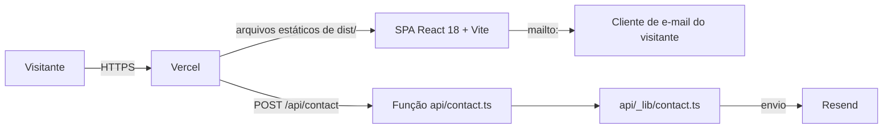

# Arquitetura

## Visão geral

- **SPA** (`src/`): uma página (`/`) com seções por âncora (`#about`, `#projects`, `#certificates`,
  `#contact`) e `NotFound` para o resto. Tema claro/escuro com `next-themes`; animações com GSAP e
  Framer Motion. O contato da interface é um link `mailto:` com assunto e corpo prontos.
- **API de contato** (`POST /api/contact`): não é chamada pela interface atual, mas continua publicada.
  Por isso é endurecida: `api/_lib/contact.ts` valida com zod (limites de tamanho), escapa o HTML do
  e-mail, descarta robôs pelo honeypot `website` e responde erros genéricos (o detalhe vai só para o
  log). Os adaptadores HTTP são finos: `api/contact.ts` (Vercel) e `server/index.js` (Docker), que
  importa o mesmo arquivo TypeScript pela remoção de tipos nativa do Node 22.18+.
- **Mesma origem:** chamadas a `/api` são relativas, sem CORS. `VITE_API_URL` existe apenas para
  apontar para outro host em casos excepcionais.

## Entrega

### Produção: Vercel

| Item | Onde |
|---|---|
| Build | `npm run build` → `dist/` (`vercel.json`) |
| Fallback da SPA | rewrite de tudo que não é `/api/*` para `/index.html` |
| Cabeçalhos | `nosniff`, `Referrer-Policy`, `X-Frame-Options: DENY`, `Permissions-Policy`, HSTS; cache imutável em `/assets/*` |
| Preview | um por PR (integração Git da Vercel) |
| Produção | merge em `main` → https://samialuvanicedev.vercel.app |
| Node | 22.x (`engines` e `.nvmrc`) |

O GitHub Actions apenas valida (`.github/workflows/ci.yml`); não publica nada.

### Alternativa: Docker (local ou servidor próprio)

`docker compose up --build` sobe `web` (nginx com `dist/`, porta 8080) e `api` (`server/index.js`,
porta 3001 interna). O nginx encaminha `/api/` e `/health` para a API e faz o fallback da SPA. O
`Dockerfile.server` copia `server/` e `api/_lib/`.

## Variáveis de ambiente

| Variável | Onde é lida | Obrigatória |
|---|---|---|
| `RESEND_API_KEY`, `CONTACT_TO_EMAIL` | API de contato | sim (sem elas a API responde 500) |
| `CONTACT_FROM_EMAIL` | API de contato | não (padrão `Portfolio <onboarding@resend.dev>`) |
| `VITE_API_URL` | SPA (bundle público) | não (padrão `/api`) |

Localmente ficam em `.env` (ignorado pelo Git); na Vercel, no painel do projeto; no Docker, no ambiente
ou no `.env`. Prefixo `VITE_` publica o valor no navegador e nunca deve carregar segredo.

## Desenvolvimento local

`npm run dev` sobe o Vite na porta 8080 com o plugin `vercel-api-dev` (`vite.config.ts`), que executa
`api/<nome>.ts` com a mesma assinatura `(req, res)` da Vercel e carrega o `.env`.

## SEO técnico

Metadados em `index.html` (title, description, canonical, Open Graph, Twitter), `public/robots.txt` com
`Sitemap:` e `public/sitemap.xml` com a URL de produção. Pendente: imagem `og:image`.

## Qualidade

Ver `docs/harness.md`. Resumo: lint sem avisos, TypeScript estrito, Vitest, Playwright + axe nos
viewports desktop e mobile, e Lighthouse CI com orçamento (`lighthouserc.json`).
