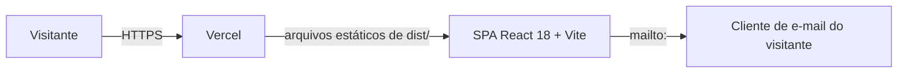

# Arquitetura

## Visão geral

- **SPA estática** (`src/`): uma página (`/`) com Hero (`#inicio`), Projetos (`#projects`),
  Expertise (`#expertise`), Experiência (`#experience`) e Contato (`#contact`), seguidos do rodapé
  (`Footer.tsx`, único `contentinfo`), além de `NotFound` para as demais rotas. Sem tema
  alternável: o esquema de cores é fixo por seção (`:root` claro e `.surface-dark` em
  `src/index.css`). Sem GSAP nem Framer Motion. O conteúdo fica em `src/content/portfolio.ts`; a
  lógica pura em `src/lib/filter-projects.ts` e `src/lib/active-section.ts`.
- **Navegação** — Links nativos de fragmento: barra superior fixa a partir de 1024 px e barra
  inferior de quatro colunas abaixo disso. A seção ativa recebe `aria-current`
  (`src/hooks/use-active-section.ts`). Os destinos de Projetos, Expertise, Experiência e Contato
  ficam em contêineres persistentes de `Index.tsx`, disponíveis enquanto o conteúdo dessas seções é
  carregado sob demanda.
- **Imagens e fontes** — Imagens dos projetos em WebP (`public/projects/`), preguiçosas. O retrato
  (`public/hero/portrait.webp`) é a imagem do LCP e é o único recurso pré-carregado no `index.html`.
  Sora e Space Grotesk vêm do próprio domínio (`@fontsource-variable/sora` e
  `@fontsource-variable/space-grotesk`, importados em `src/fonts.ts`); `src/main.tsx` carrega esse
  módulo por import dinâmico depois do evento `load`, e o texto troca da fonte do sistema com
  `font-display: swap`. Não há fontes do Google, `preconnect` nem `preload` de fontes. Até a troca,
  valem os fallbacks de `src/index.css`: `@font-face` com `local()` (Arial e compatíveis — Liberation
  Sans, Helvetica — e Roboto, faces regular e bold) e `size-adjust`, `ascent-override`,
  `descent-override` e `line-gap-override`. São três famílias: `Space Grotesk Fallback` (títulos),
  `Sora Fallback` (corpo) e `Space Grotesk Hero Fallback` (classe `font-hero`: nome do hero e marca
  d'água, ajustada pela linha mais longa, "LUVANICE"). Assim o texto ocupa praticamente o mesmo
  espaço e o nome não passa da borda no celular; com a fonte carregada, nada muda. Se as fontes ou o
  hero mudarem, os valores precisam ser medidos de novo, com o método de
  `specs/0005-fallback-fonte-hero/plan.md` (`measureText` no Chromium).
- **Sem backend:** o contato é um link `mailto:` com assunto e corpo prontos, montado por
  `src/lib/contact.ts`. O projeto não tem funções serverless nem variáveis de ambiente. A antiga
  API de contato (Resend) foi removida no PR #2 por não ser usada pela interface; a versão endurecida
  dela (validação, escape, honeypot) fica no histórico do Git caso um formulário volte.

## Entrega

### Produção: Vercel

| Item | Onde |
|---|---|
| Build | `npm run build` → `dist/` (`vercel.json`) |
| Fallback da SPA | rewrite de todas as rotas para `/index.html` (arquivos estáticos têm precedência) |
| Cabeçalhos | `nosniff`, `Referrer-Policy`, `X-Frame-Options: DENY`, `Permissions-Policy`, HSTS; cache imutável em `/assets/*`; 7 dias (`max-age=604800, stale-while-revalidate=86400`) em `/hero/*`, `/projects/*` e `/og-image.jpg` |
| Preview | um por PR (integração Git da Vercel) |
| Produção | merge em `main` → https://samialuvanicedev.vercel.app |
| Node | 22.x (`engines` e `.nvmrc`) |

Imagens de `public/` não têm hash no nome: imagem substituída ganha nome novo (e a referência é
atualizada), ou a versão antiga pode ser servida do cache por até 7 dias.

O GitHub Actions apenas valida (`.github/workflows/ci.yml`); não publica nada.

### Alternativa: Docker (local ou servidor próprio)

`docker compose up --build` gera o build e o serve com nginx na porta 8080 (`Dockerfile`,
`nginx.conf`), com fallback da SPA. O `nginx.conf` não replica os cabeçalhos de segurança nem de
cache do `vercel.json`.

## SEO técnico

Metadados em `index.html` (title, description, canonical, Open Graph, Twitter), `public/robots.txt` com
`Sitemap:` e `public/sitemap.xml` com a URL de produção.

Prévia de link: `public/og-image.jpg` (1200 × 630, JPEG) é gerada do hero do build por
`node scripts/generate-og-image.mjs` (rode depois de `npm run build`). O `index.html` declara
`og:image` com largura, altura, tipo e texto alternativo, `twitter:card` `summary_large_image` e
`twitter:image` com texto alternativo.

## Qualidade

Ver `docs/harness.md`. Resumo: lint sem avisos, TypeScript estrito, Vitest, Playwright + axe nos
viewports desktop e mobile (incluindo larguras de 320 a 1440 px, cores forçadas e movimento
reduzido), e Lighthouse CI com orçamento (`lighthouserc.json`).
