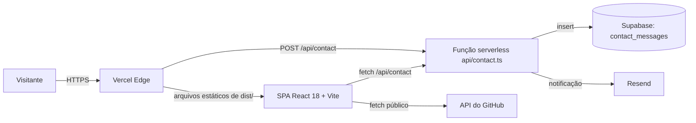

# Arquitetura

## Visão geral

- **SPA** (`src/`): uma página (`/`) com seções por âncora (`#about`, `#projects`, `#certificates`,
  `#contact`) e `NotFound` para o resto. Tema claro/escuro com `next-themes`; animações com GSAP e
  Framer Motion. A atividade do GitHub vem da API pública, com cache de 5 minutos em `localStorage`.
- **Função de contato** (`api/contact.ts`): adaptador HTTP que monta as dependências a partir do
  ambiente e delega para `api/_lib/contact.ts` (validação Zod com limites, escape de HTML do e-mail,
  persistência e notificação). A falha do e-mail não perde a mensagem, que já foi salva. Um campo honeypot invisível (`website`)
  descarta envios de robôs com resposta de sucesso, sem salvar. Erros
  respondem mensagem genérica; o detalhe vai só para o log da função.
- **Mesma origem:** o front chama `/api` relativo, sem CORS. `VITE_API_URL` existe apenas para
  apontar para outro host em casos excepcionais.

## Entrega (Vercel)

| Item | Onde |
|---|---|
| Build | `npm run build` → `dist/` (`vercel.json`) |
| Fallback da SPA | rewrite de tudo que não é `/api/*` para `/index.html` |
| Cabeçalhos | `nosniff`, `Referrer-Policy`, `X-Frame-Options: DENY`, `Permissions-Policy`, HSTS; cache imutável em `/assets/*` |
| Preview | um por PR (integração Git da Vercel) |
| Produção | merge em `main` → https://samialuvanicedev.vercel.app |
| Node | 22.x (`engines` e `.nvmrc`) |

O GitHub Actions apenas valida (`.github/workflows/ci.yml`); não publica nada.

## Variáveis de ambiente

| Variável | Onde é lida | Obrigatória |
|---|---|---|
| `SUPABASE_URL`, `SUPABASE_SERVICE_ROLE_KEY` | função de contato | sim (sem elas a função responde 500) |
| `RESEND_API_KEY`, `CONTACT_TO_EMAIL` | função de contato | não (sem elas não há e-mail) |
| `CONTACT_FROM_EMAIL` | função de contato | não (padrão `Portfolio <onboarding@resend.dev>`) |
| `VITE_API_URL` | SPA (bundle público) | não (padrão `/api`) |

Localmente ficam em `.env` (ignorado pelo Git); em produção, no painel da Vercel. Prefixo `VITE_`
publica o valor no navegador e nunca deve carregar segredo.

## Desenvolvimento local

`npm run dev` sobe o Vite na porta 8080 com o plugin `vercel-api-dev` (`vite.config.ts`), que executa
`api/<nome>.ts` com a mesma assinatura `(req, res)` da Vercel e carrega o `.env`. Não há servidor
separado.

## SEO técnico

Metadados em `index.html` (title, description, canonical, Open Graph, Twitter), `public/robots.txt` com
`Sitemap:` e `public/sitemap.xml` com a URL de produção. Pendente: imagem `og:image`.

## Qualidade

Ver `docs/harness.md`. Resumo: lint sem avisos, TypeScript estrito, Vitest, Playwright + axe nos
viewports desktop e mobile, e Lighthouse CI com orçamento (`lighthouserc.json`).
