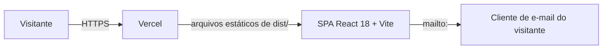

# Arquitetura

## Visão geral

- **SPA estática** (`src/`): uma página (`/`) com Hero (`#inicio`), Projetos (`#projects`),
  Expertise (`#expertise`), Experiência (`#experience`) e Contato (`#contact`), seguidos do rodapé
  (`Footer.tsx`, único `contentinfo`), além de `NotFound` para as demais rotas. Sem tema
  alternável: o esquema de cores é fixo por seção (`:root` claro e `.surface-dark` em
  `src/index.css`). Sem GSAP nem Framer Motion. O conteúdo fica em `src/content/portfolio.ts`; a
  lógica pura em `src/lib/filter-projects.ts` e `src/lib/active-section.ts`.
- **Navegação** — Links nativos de fragmento: barra superior fixa a partir de 1024 px e barra
  inferior de quatro colunas abaixo disso. A seção ativa recebe `aria-current`
  (`src/hooks/use-active-section.ts`). Os destinos de Projetos, Expertise, Experiência e Contato
  ficam em contêineres persistentes de `Index.tsx`, disponíveis enquanto o conteúdo dessas seções é
  carregado sob demanda.
- **Imagens e fontes** — Imagens dos projetos em WebP (`public/projects/`), preguiçosas. O retrato
  (`public/hero/portrait.webp`) é a imagem do LCP e é pré-carregado no `index.html`, assim como as
  fontes do Google, que entram por `preload` com troca no `onload` para não bloquear a renderização.
- **Sem backend:** o contato é um link `mailto:` com assunto e corpo prontos, montado por
  `src/lib/contact.ts`. O projeto não tem funções serverless nem variáveis de ambiente. A antiga
  API de contato (Resend) foi removida no PR #2 por não ser usada pela interface; a versão endurecida
  dela (validação, escape, honeypot) fica no histórico do Git caso um formulário volte.

## Entrega

### Produção: Vercel

| Item | Onde |
|---|---|
| Build | `npm run build` → `dist/` (`vercel.json`) |
| Fallback da SPA | rewrite de todas as rotas para `/index.html` (arquivos estáticos têm precedência) |
| Cabeçalhos | `nosniff`, `Referrer-Policy`, `X-Frame-Options: DENY`, `Permissions-Policy`, HSTS; cache imutável em `/assets/*` |
| Preview | um por PR (integração Git da Vercel) |
| Produção | merge em `main` → https://samialuvanicedev.vercel.app |
| Node | 22.x (`engines` e `.nvmrc`) |

O GitHub Actions apenas valida (`.github/workflows/ci.yml`); não publica nada.

### Alternativa: Docker (local ou servidor próprio)

`docker compose up --build` gera o build e o serve com nginx na porta 8080 (`Dockerfile`,
`nginx.conf`), com fallback da SPA.

## SEO técnico

Metadados em `index.html` (title, description, canonical, Open Graph, Twitter), `public/robots.txt` com
`Sitemap:` e `public/sitemap.xml` com a URL de produção. Pendente: imagem `og:image`.

## Qualidade

Ver `docs/harness.md`. Resumo: lint sem avisos, TypeScript estrito, Vitest, Playwright + axe nos
viewports desktop e mobile (incluindo larguras de 320 a 1440 px, cores forçadas e movimento
reduzido), e Lighthouse CI com orçamento (`lighthouserc.json`).
